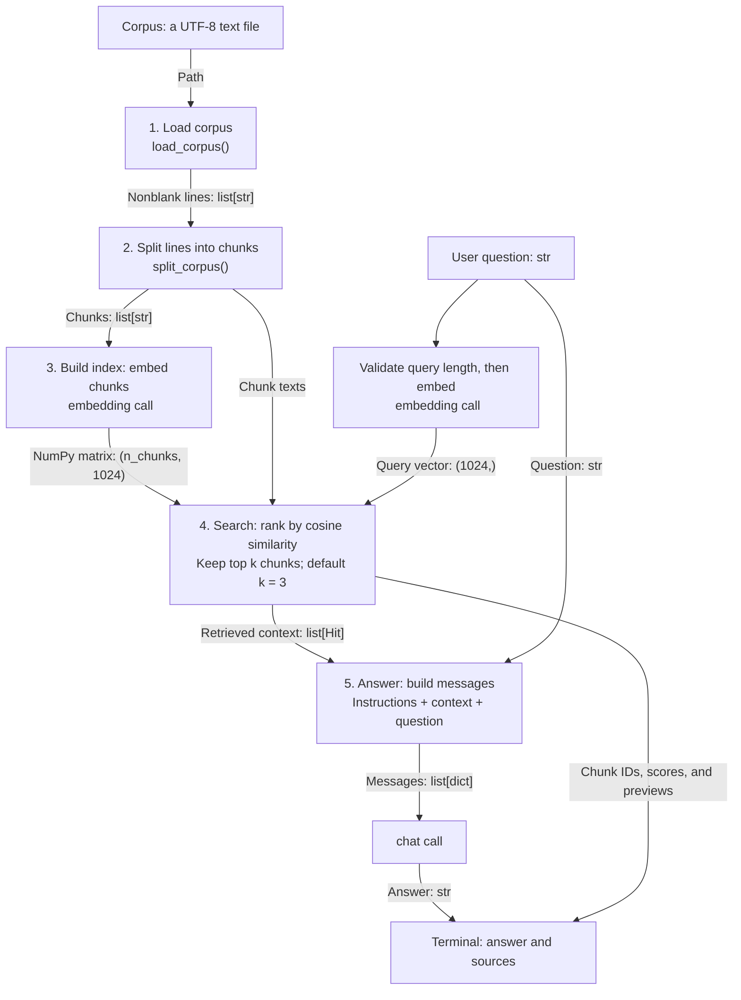

# retrieval_app Workflow

`retrieval_app` is a command-line retrieval-augmented generation (RAG) app. It searches a text file for passages related to a question, then gives those passages to a chat model to help it answer.

## Workflow diagram



The diagram renders in a Markdown viewer with Mermaid support.

## Walk through the five stages

| Stage | What happens | Code |
| --- | --- | --- |
| **1. Load** | Read the UTF-8 file into a list of nonblank lines. | [corpus.py](retrieval_app/corpus.py): `load_corpus()` |
| **2. Split** | Keep lines separate and split long lines at literal periods, targeting 1,000 characters per chunk. Chunks do not overlap and can exceed the target when a period is farther away or absent. | [corpus.py](retrieval_app/corpus.py): `split_corpus()` |
| **3. Index** | Convert each chunk into an embedding: a numeric vector used to compare meaning. Store the vectors in a NumPy matrix, with one row per chunk. | [index.py](retrieval_app/index.py): `build_index()`, `embed_texts()` |
| **4. Retrieve** | Check the question's token limit, embed it with the same model, compare it against every chunk using cosine similarity, and return up to `k` hits. Each `Hit` contains a chunk ID, text, and score. | [index.py](retrieval_app/index.py): `search()` |
| **5. Answer** | Build messages containing instructions, labeled chunks, and the question. Ask the chat model to answer from the context and cite supporting chunk labels. | [answer.py](retrieval_app/answer.py): `build_messages()`, `answer()` |

[__main__.py](retrieval_app/__main__.py) connects these stages: it reads the command-line arguments, loads optional `.env` settings, selects the corpus, runs the pipeline, and prints the answer, retrieved sources, and timing information.

## Details to mention when explaining it

- **Current chunking change:** line boundaries are preserved, and long lines split at periods without overlap. The reason for this choice is recorded in [DECISIONS.md](DECISIONS.md).
- **Models:** both chunk and query embeddings use `ollama/qwen3-embedding:0.6b` with 1,024 dimensions. Answer generation uses `ollama/qwen3:4b-instruct`. Calls go through LiteLLM to `LLM_API_BASE`, which defaults to `http://localhost:11434`.
- **Index lifetime:** the index lives in memory and is rebuilt for each command. A normal run with a nonempty corpus and positive `k` makes two embedding requests—one for the chunks and one for the question—plus one chat request.
- **Missing information:** retrieval has no minimum similarity threshold. The prompt asks the model to say it lacks information when the retrieved context does not support an answer; this is an instruction to the model, not a guaranteed result.
- **Sources:** the terminal lists the retrieved chunks with their IDs, similarity scores, and short previews. `--show-chunks` adds a longer preview of each retrieved chunk.

## Example command

Run from the `Week 1` directory with the configured model service available:

```bash
uv run python -m retrieval_app "What does it mean to think like a CEO?" --corpus data/Think_Like_A_CEO_kb.txt --show-chunks
```

This explicitly selects the corpus. Without `--corpus`, the app looks for exactly one file matching `data/*_kb.txt`.
